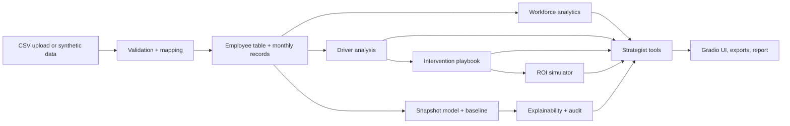

# PULSE AI — People Intelligence & Retention Studio
Understand the patterns. Improve the workplace.

## Business problem and features
Employee turnover brings recruitment costs, lost knowledge and disruption. PULSE AI integrates workload, compensation, engagement, absence, training and career data to find organisational patterns associated with exits, compare retention interventions and estimate scenario costs and benefits. Bundled data is **fictional synthetic data**.
Features: CSV upload with column mapping and validation, headcount-safe attrition analytics, driver analysis with intervals and effect sizes, optional calibrated attrition model with baseline comparison, permutation importance, restricted employee-level view, evidence-linked intervention playbook, ROI simulator, rule-based strategist with optional LLM, responsible-AI audit, exports and report.

## Architecture


## Installation and launch
```
pip install -r requirements.txt
python app.py
```
Google Colab: paste `app.py` into one cell and run it.

## Data, preprocessing and methodology
See `docs/data_dictionary.md` and `docs/methodology.md`. If auto-detection fails, map columns such as `employee_id=emp_no, overtime_hours=ot`.

## Model, explainability and limitations
Calibrated model with a department-average baseline; permutation importance and what-if explanations are not causal. See `docs/limitations.md`.

## LLM configuration
Optional: Anthropic or an OpenAI-compatible endpoint; enter a key in the app (session only) or set `ANTHROPIC_API_KEY` / `OPENAI_API_KEY`. Without a key a deterministic assistant is used. Only aggregated tool results are sent.

## Intervention logic and ROI
Evidence-to-intervention rules and the ROI formulas are in `docs/methodology.md`. Scenario outputs are assumptions, not savings.

## Privacy and responsible AI
See `docs/responsible_ai.md`. Never commit real employee data or keys. Exports are aggregated.

## Tests and deployment
```
pip install pytest
pytest tests
```
Deploy `app.py` as a Hugging Face Space (SDK: Gradio) with your own credentials. Add screenshots to `screenshots/`.
